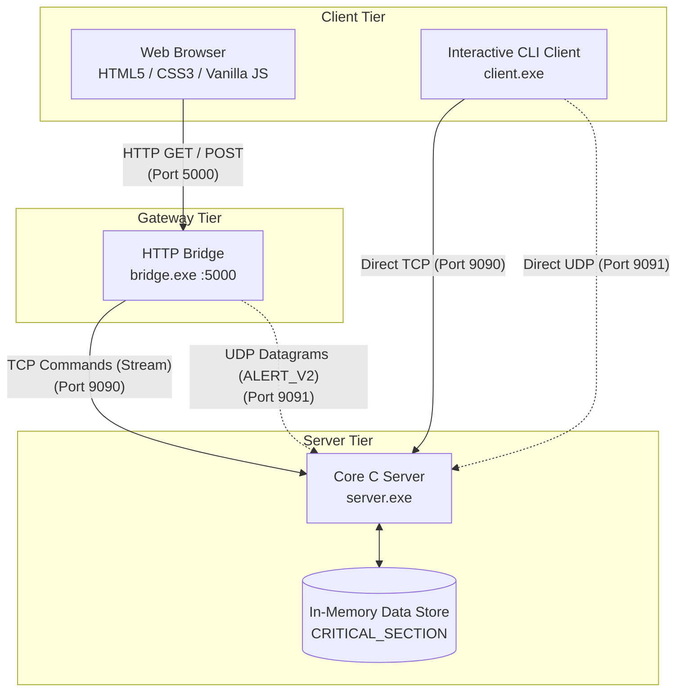

# NetLink – TCP/UDP-Based Client-Server Pothole Reporting System

A hands-on **Computer Networks (CNS AAT)** project demonstrating socket programming, client-server architectures, and dual transport-layer protocols (**TCP** and **UDP**) built from scratch in **C and Windows Sockets (Winsock)**.

NetLink provides an intuitive single-page web portal where citizens can submit comprehensive road hazard reports over reliable TCP or transmit rapid location telemetry over connectionless UDP. A custom C HTTP bridge acts as the application gateway between browser clients and the multi-threaded C server.

---

## Table of Contents

- [Key Features](#key-features)
- [Website Preview](#website-preview)
- [Technology Stack](#technology-stack)
- [System Architecture](#system-architecture)
- [Ports and Protocols](#ports-and-protocols)
- [How the Project Works](#how-the-project-works)
  - [1. TCP Formal Report Flow](#1-tcp-formal-report-flow)
  - [2. UDP Quick Alert Flow](#2-udp-quick-alert-flow)
- [Report Priority System](#report-priority-system)
- [Report Statuses](#report-statuses)
- [Project Structure](#project-structure)
- [Installation and Setup](#installation-and-setup)
- [Running the Application](#running-the-application)
- [Computer Networks Concepts Demonstrated](#computer-networks-concepts-demonstrated)
- [Project Limitations](#project-limitations)
- [Additional Documentation](#additional-documentation)

---

## Key Features

- **Live Dashboard**: Real-time overview displaying aggregate statistics (*Total Reports*, *Active*, *Resolved*, *Critical*), an activity feed, and quick-action navigation.
- **Automatic GPS Location Tracker & Reverse Geocoding**: Uses W3C Geolocation API (`enableHighAccuracy: true`) and OpenStreetMap Nominatim to automatically acquire device GPS coordinates, browser-reported accuracy in metres, and reverse-geocode readable road and locality names. Includes an interactive Leaflet map preview and clickable Google Maps links.
- **AI-Powered Pothole Image Recognition**: Client-side MobileNetV2 Deep CNN binary classifier (TensorFlow.js) that analyzes uploaded road photographs in real time to determine whether a pothole is present with exact confidence probability, backed by a C base64 image upload gateway.
- **TCP-Based Pothole Reporting (`REPORT_V3`)**: Complete intake form capturing road name, locality, severity, traffic impact, GPS coordinates, GPS accuracy, photo evidence, and descriptions with client and server-side validation.
- **Server-Generated Report IDs**: Automatically generates sequential, formatted ticket IDs (`PTH-XXXXXX` for TCP reports, `UDP-XXXXXX` for UDP alerts).
- **Automated Priority Calculation**: Calculates priority levels (`LOW`, `MEDIUM`, `HIGH`, `CRITICAL`) using an algorithmic matrix combining hazard severity and road traffic density.
- **Real-Time Duplicate Checking**: Performs asynchronous duplicate lookups (`CHECK|road|locality`) as users type, warning of existing unresolved road tickets.
- **Quick UDP Location Alerts**: Transmits lightweight, connectionless hazard alerts (`ALERT_V2`) directly to the server's UDP listener with zero connection-handshake overhead.
- **Report Listing & Detail Inspection**: Full case management allowing users to browse, filter, search by locality or road, and view in-depth report records.
- **Lifecycle Status Updates**: Simulated tracking workflow supporting status transitions (`Pending` → `Under Review` → `In Progress` → `Resolved`).
- **Network Information & Diagnostics**: Built-in diagnostic tab with interactive TCP ping latency tests, server configuration readouts, and live connection statistics.
- **Live Communication Logs**: Real-time network monitor displaying outgoing commands and incoming responses with color-coded protocol badges (`TCP`, `UDP`, `HTTP`).
- **Educational Networking Guide**: Embedded reference cards explaining the OSI model, TCP vs. UDP tradeoffs, socket lifecycle, and framing techniques.
- **Interactive CLI Client**: Standalone C console utility (`client.c`) providing an interactive terminal interface to test all server commands directly.

---

## Website Preview

> [!NOTE]
> Screenshots can be captured and saved under an `assets/` or `screenshots/` directory for visual presentation. The portal features five distinct responsive sections:

### 1. Dashboard
Displays key metrics cards (*Total Reports*, *Active*, *Resolved*, *Critical*), a live activity ticker, and quick-start actions.
*(Placeholder: Add screenshot of `http://127.0.0.1:5000/#dashboard`)*

### 2. TCP Report Submission
A structured form with live duplicate warnings, real-time priority estimation, and coordinate inputs.
*(Placeholder: Add screenshot of `http://127.0.0.1:5000/#report`)*

### 3. UDP Alerts
A rapid-dispatch interface for emergency location alerts and an interactive feed of the last 10 UDP datagrams with inline status dropdowns.
*(Placeholder: Add screenshot of `http://127.0.0.1:5000/#alerts`)*

### 4. All Reports
Case management table and card grid with multi-parameter filtering, search, and detailed inspection modals.
*(Placeholder: Add screenshot of `http://127.0.0.1:5000/#records`)*

### 5. Network Information
Diagnostic console featuring real-time TCP ping testing, server client counts, protocol comparisons, and chronological wire logs.
*(Placeholder: Add screenshot of `http://127.0.0.1:5000/#network`)*

---

## Technology Stack

| Technology | Purpose |
|---|---|
| **C (ISO C99)** | Backend server (`server.c`), HTTP gateway bridge (`bridge.c`), and CLI client (`client.c`). |
| **Windows Sockets (Winsock 2)** | Native Windows networking library (`ws2_32`) providing raw TCP stream and UDP datagram sockets. |
| **HTML5** | Semantic structure for the single-page responsive web dashboard. |
| **Vanilla CSS3** | Custom dark navy theme, flexbox/grid layouts, card components, and protocol badges (no heavy CSS frameworks). |
| **Vanilla JavaScript (ES6)** | Dynamic client routing, DOM updates, asynchronous `fetch` API, duplicate checks, and live polling. |
| **HTTP (over TCP)** | Application-layer communication between browser clients and the C HTTP bridge on port `5000`. |
| **TCP** | Connection-oriented, reliable transport protocol for formal reports and queries on port `9090`. |
| **UDP** | Connectionless, lightweight transport protocol for emergency location telemetry on port `9091`. |

---

## System Architecture

NetLink uses a 3-tier architecture that bridges standard web browsers to native C Winsock programs:



### Component Responsibilities

- **Web Browser**: Renders the user interface, validates user inputs, sends HTTP requests to the bridge, and polls status endpoints.
- **`bridge.c` (HTTP Bridge)**: Acts as a custom web server and protocol translator on port `5000`. It serves static files (`web/`), maintains a persistent TCP session per browser tab to `server.c` on port `9090`, and dispatches UDP datagrams to port `9091`.
- **`server.c` (Core Winsock Server)**: Multi-threaded engine listening on TCP port `9090` and UDP port `9091`. It parses commands, enforces synchronization with critical sections, calculates priority ratings, and stores reports in memory.
- **`client.c` (CLI Client)**: An optional standalone console program that connects directly to the server via TCP and UDP without needing a browser or HTTP bridge.

---

## Ports and Protocols

| Port | Protocol | Used By | Purpose |
|---|---|---|---|
| **5000** | HTTP over TCP | Web Browser ↔ `bridge.exe` | Serves the web interface and handles REST-like JSON API requests. |
| **9090** | TCP | `bridge.exe` / `client.exe` ↔ `server.exe` | Transmits formal reports, queries, report details, status updates, duplicate checks, and ping diagnostics. |
| **9091** | UDP | `bridge.exe` / `client.exe` ↔ `server.exe` | Transmits quick location alerts (`ALERT_V2`) and receives application-level ACKs for alert status changes. |

---

## How the Project Works

### 1. TCP Formal Report Flow

```text
Browser                 bridge.exe               server.exe
  │                         │                        │
  │  1. HTTP POST /api/report│                        │
  ├────────────────────────►│                        │
  │                         │  2. REPORT|... \n      │
  │                         ├───────────────────────►│
  │                         │                        │  3. Validate & Score Priority
  │                         │                        │  4. Assign ID PTH-XXXXXX
  │                         │                        │  5. Store in reports[]
  │                         │  6. JSON Response Line │
  │                         │◄───────────────────────┤
  │  7. HTTP 200 (JSON)     │                        │
  │◄────────────────────────┤                        │
```

1. **Submission**: User completes the report form in the browser (or clicks **Detect My Location** for GPS coordinates and reverse geocoding) and clicks **Submit Report**.
2. **HTTP Translation**: The browser sends an HTTP POST to `http://127.0.0.1:5000/api/report` with JSON payload.
3. **TCP Transmission**: `bridge.exe` validates coordinates and accuracy, then formats the payload into a newline-terminated string using the `REPORT_V3` protocol:
   ```text
   REPORT_V3|High|Medium|Ring Road|Hebbal|13.035800|77.597000|12.50|Deep crater near underpass|no|img_abc123.jpg\n
   ```
   *(Note: The bridge preserves backward compatibility with `REPORT_V2` for reports with images only, and legacy `REPORT` for text-only submissions from CLI clients).*
4. **Server Processing**: A dedicated worker thread in `server.exe` reads the stream, computes priority, stores coordinates and accuracy radius, generates an ID (e.g., `PTH-000001`), and locks the thread-safe store.
5. **Response**: `server.exe` returns a JSON string over the same TCP socket.
6. **UI Update**: `bridge.exe` passes the response to the browser, updating the dashboard, report cards, Leaflet map, and Google Maps deep links.

### 2. UDP Quick Alert Flow

```text
Browser                 bridge.exe               server.exe
  │                         │                        │
  │  1. HTTP POST /api/udp  │                        │
  ├────────────────────────►│                        │
  │                         │  2. sendto() Datagram  │
  │                         ├ - - - - - - - - - - - ►│ (Port 9091)
  │  3. HTTP 200 {sent:true}│                        │  4. recvfrom() in udp_handler
  │◄────────────────────────┤                        │  5. Assign ID UDP-XXXXXX
  │                         │                        │  6. Store in rolling buffer
```

1. **Dispatch**: User enters location and severity in the Quick Alert panel and clicks **Send Emergency Alert**.
2. **Datagram Transmission**: `bridge.exe` packages the alert into a compact string and calls Winsock `sendto()`:
   ```text
   ALERT_V2|High|Low|no|Airport Expressway|Yelahanka
   ```
3. **Connectionless Delivery**: `sendto()` immediately places the packet on the network stack without establishing a handshake or waiting for an acknowledgment.
4. **Server Storage**: The server's background UDP thread receives the packet via `recvfrom()`, assigns an ID (e.g., `UDP-000001`), and stores it in a 10-slot circular buffer.
5. **Application-Level ACK**: When an alert status is modified, `ALERT_STATUS|id|status` is sent over UDP, and the server returns an explicit application-level `ACK|STATUS|...` datagram.

---

## Report Priority System

NetLink automatically classifies every report using a deterministic scoring engine:

### 1. Scoring Matrix

Each input parameter is mapped to a numeric score:
- **Severity**: Low = `1`, Medium = `2`, High = `3`
- **Traffic Density**: Low = `1`, Medium = `2`, High = `3`

### 2. Combined Priority Calculation

$$\text{Total Score} = \text{Severity Score} + \text{Traffic Score}$$

| Combined Score | Calculated Priority | Recommended Action |
|:---:|:---:|---|
| **2** | **LOW** | Regular road maintenance schedule; routine monitoring. |
| **3 – 4** | **MEDIUM** | Road inspection requested; caution advisory. |
| **5** | **HIGH** | Prompt physical inspection; warning signage recommended. |
| **6** | **CRITICAL** | Urgent intervention required; notify emergency road crews. |

> [!IMPORTANT]
> If **Immediate Danger** is flagged (`yes`), the system automatically overrides standard advice with emergency safety directives while preserving the computed priority score.

---

## Report Statuses

Every report moves through a 4-stage lifecycle:

```text
[ Pending ] ────► [ Under Review ] ────► [ In Progress ] ────► [ Resolved ]
```

- **`Pending`**: Default status upon submission. Awaiting municipal triage.
- **`Under Review`**: Ticket acknowledged and queued for on-site assessment.
- **`In Progress`**: Repair contractors or road inspection teams dispatched.
- **`Resolved`**: Repair completed and hazard closed.

*(Note: In this academic demonstration, status changes can be performed directly by the user to demonstrate state synchronization.)*

---

## Project Structure

```text
NetLink/
├── server.c         # Multi-threaded Winsock C server (TCP 9090, UDP 9091)
├── bridge.c         # Custom C HTTP server & protocol translator (HTTP 5000)
├── client.c         # Interactive command-line test client
├── start.bat        # Automated one-click build and launch script for Windows
├── README.md        # Main repository overview and setup guide
├── .gitignore       # Git exclusions (binaries, logs, temporary files)
├── docs/            # Project documentation and guides
│   ├── ABOUT.md     # Beginner-friendly guide and viva examination preparation
│   ├── FEATURES.md  # Detailed technical feature catalog and protocol specs
│   └── how_to_run.md# Quick copy-paste terminal commands
└── web/             # Frontend single-page application
    ├── index.html   # Semantic UI layout (5 dashboard sections)
    ├── style.css    # Responsive dark navy styling system
    └── script.js    # Client-side routing, API integrations, and event handling
```

---

## Installation and Setup

### Prerequisites

- **Operating System**: Windows 10 or Windows 11.
- **C Compiler**: GCC via **MinGW-w64** or **MSYS2 (UCRT64 / MINGW64)**.
- **Libraries**: Windows Sockets 2 (`-lws2_32` — included with Windows/MinGW).
- **Git** *(Optional)*: For repository cloning and version control.

### Compilation

Open PowerShell or Command Prompt in the project directory and compile using GCC:

```powershell
gcc -o server.exe server.c -lws2_32
gcc -o bridge.exe bridge.c -lws2_32
gcc -o client.exe client.c -lws2_32
```

*(Optional strict compilation flags: `gcc -Wall -Wextra -o server.exe server.c -lws2_32`)*

---

## Running the Application

### Option A: One-Click Startup (Recommended)

Double-click **`start.bat`** or run it from the terminal:

```powershell
.\start.bat
```

`start.bat` will automatically:
1. Verify if `gcc` is available and compile missing executables.
2. Launch `server.exe` minimised on TCP `9090` and UDP `9091`.
3. Launch `bridge.exe` minimised on HTTP `5000`.
4. Launch your default browser directly to `http://127.0.0.1:5000/`.

---

### Option B: Manual Multi-Terminal Startup

Open **two separate terminals** in the project directory:

**Terminal 1 — Core Server:**
```powershell
.\server.exe
```
*Console output:*
```text
[HH:MM:SS] NetLink server listening on TCP 0.0.0.0:9090 and UDP 0.0.0.0:9091
```

**Terminal 2 — HTTP Bridge:**
```powershell
.\bridge.exe
```
*Console output:*
```text
[HH:MM:SS] HTTP bridge listening on http://127.0.0.1:5000
```

Open your browser and navigate to:
```text
http://127.0.0.1:5000/
```

---

### Option C: Running the Interactive CLI Client

Open a **third terminal** to interact directly with the C server:

```powershell
.\client.exe
```

Supported CLI commands:
- `list` — Retrieve all reports over TCP (`LIST`).
- `report` — Interactively submit a formal report (`REPORT|...`).
- `detail <id>` — Inspect a specific report (`DETAIL|id`).
- `status <id>` — Update a report status (`STATUS|id|status`).
- `check` — Run a duplicate check (`CHECK|road|locality`).
- `ping` — Run a connectivity test (`PING`).
- `stats` — Inspect server configuration and client connections (`STATS`).
- `udp` — Send an emergency location alert datagram (`ALERT_V2|...`).
- `udp-list` — List stored UDP alerts (`ALERTS`).
- `udp-status <id>` — Update alert status with application ACK (`ALERT_STATUS|...`).
- `quit` — Close connection and exit.

---

## Computer Networks Concepts Demonstrated

| Networking Concept | Implementation in NetLink |
|---|---|
| **Client-Server Architecture** | Centralized `server.c` processes requests from web browsers (via `bridge.c`) and CLI clients (`client.c`). |
| **HTTP (Application Layer)** | Custom HTTP server in `bridge.c` parses request lines, query parameters, and JSON payloads. |
| **TCP (Transport Layer)** | Reliable, connection-oriented channel on port `9090` for critical data integrity (formal tickets). |
| **UDP (Transport Layer)** | Low-overhead, connectionless datagram channel on port `9091` for rapid telemetry. |
| **Socket Programming** | Low-level Winsock API usage: `socket()`, `bind()`, `listen()`, `accept()`, `send()`, `recv()`, `sendto()`, and `recvfrom()`. |
| **Port Numbers & Multiplexing** | Disambiguating services on a single host (HTTP on `5000`, TCP on `9090`, UDP on `9091`). |
| **TCP Three-Way Handshake** | Handshake execution when client sockets connect to port `9090`. |
| **Reliable Byte-Stream Delivery** | Guaranteeing that large reports arrive intact without missing fields or out-of-order bytes. |
| **Newline Message Framing** | Solving TCP stream boundary issues by delimiting distinct commands with `\n`. |
| **Application-Level ACKs** | Sending custom `ACK|STATUS|...` or `NACK` datagrams over UDP to verify delivery. |
| **Multithreading & Concurrency** | `CreateThread()` spawns dedicated worker threads per TCP client, plus a dedicated UDP listener thread. |
| **Critical Sections** | Win32 `CRITICAL_SECTION` primitives prevent data races when multiple threads access the shared report array. |
| **Loopback vs. All Interfaces** | `server.c` binds to `0.0.0.0` (`INADDR_ANY`), while `bridge.c` binds to `127.0.0.1` (localhost). |

---

## Project Limitations

- **In-Memory Storage**: All reports (`MAX_REPORTS = 50`) and UDP alerts (`MAX_UDP_ALERTS = 10`) are stored in volatile RAM. Restarting `server.exe` clears all data.
- **Unreliable UDP Path**: Standard UDP datagrams are best-effort; packets may be lost if network queues overflow.
- **Academic Demonstration**: Built specifically for educational evaluation; does not include production authentication, role-based access control (RBAC), or TLS/HTTPS encryption.
- **Simulated Workflow**: Status transitions demonstrate state synchronization and do not dispatch actual civic maintenance machinery.

---

## Additional Documentation

For deeper exploration of the project implementation, architecture, and evaluation prep:

- **[ABOUT.md](docs/ABOUT.md)** — A complete, beginner-friendly guide covering project background, end-to-end data flows, UI element walkthroughs, and viva examination Q&A.
- **[FEATURES.md](docs/FEATURES.md)** — Exhaustive feature catalog documenting wire protocols, payload schemas, validation rules, and error codes.
- **[how_to_run.md](docs/how_to_run.md)** — Concise copy-paste terminal commands for building and running.

---

*NetLink — Developed for Computer Networks (CNS AAT) using C, Windows Sockets, and Web Technologies.*
