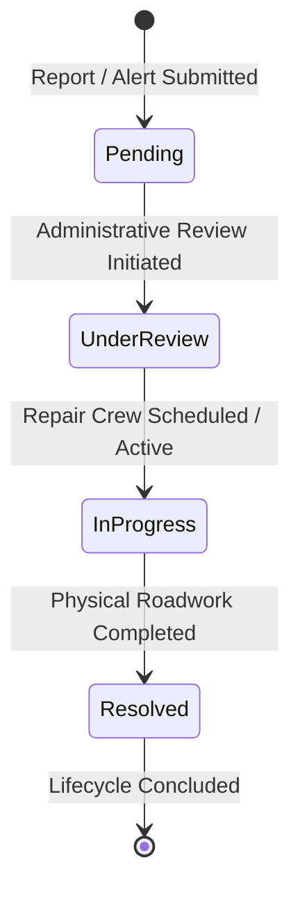
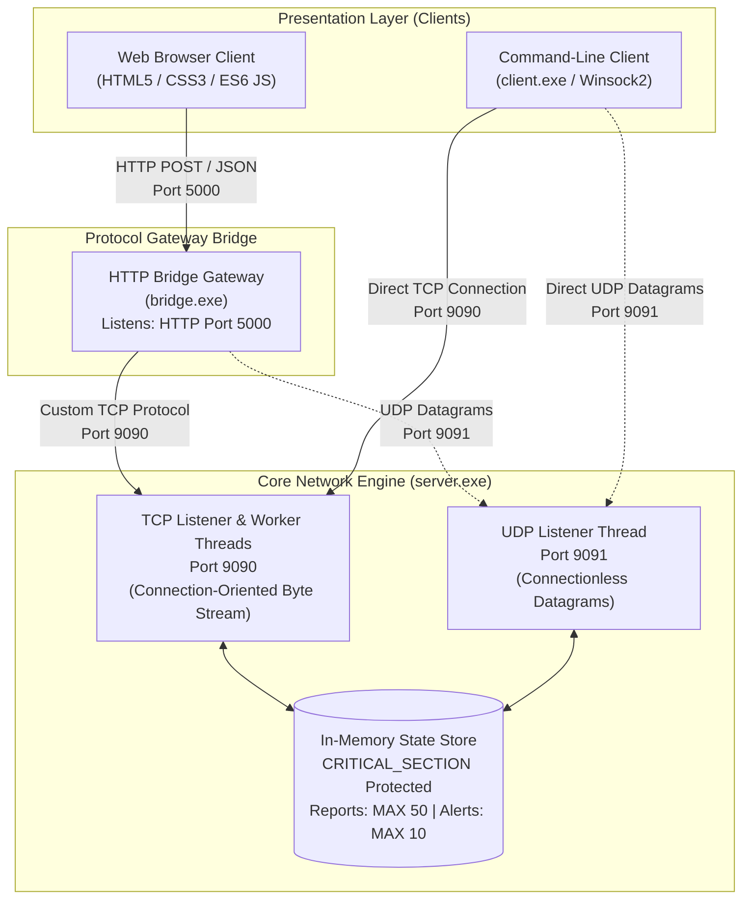

# CNS-AAT1-REPORT

---

**Project Title:** NetLink – TCP/UDP-Based Client-Server Pothole Reporting System  
**Course Name:** Computer Networks and Security (CNS)  
**Academic Assessment:** Alternative Assessment Tool 1 (AAT1)  
**Maximum Marks:** 50 Marks  
**Primary Academic Objective:** Developing a Client-Server / peer-to-peer process architecture and demonstrating error-free and secure communications between distributed entities.  
**Platform / Environment:** Microsoft Windows (Winsock2 API, C99, MinGW-w64 / MSYS2 UCRT64, HTML5/CSS3/JavaScript)  

---

## Table of Contents

- [CNS-AAT1-REPORT](#cns-aat1-report)
  - [1. Area of Application](#1-area-of-application)
    - [1.1 Domain and Real-World Context](#11-domain-and-real-world-context)
    - [1.2 The Problem Addressed by NetLink](#12-the-problem-addressed-by-netlink)
    - [1.3 Core Workflow: Submission, Processing, and Status Lifecycle](#13-core-workflow-submission-processing-and-status-lifecycle)
    - [1.4 Suitability of the Client-Server Architecture](#14-suitability-of-the-client-server-architecture)
    - [1.5 Practical Relevance and Academic Scope Boundaries](#15-practical-relevance-and-academic-scope-boundaries)
  - [2. Design/Algorithms](#2-designalgorithms)
    - [2.1 Overall System Architecture](#21-overall-system-architecture)
    - [2.2 Client Design](#22-client-design)
      - [2.2.1 Browser-Based Web Client](#221-browser-based-web-client)
      - [2.2.2 Interactive Command-Line Interface (CLI) Client](#222-interactive-command-line-interface-cli-client)
    - [2.3 Server Design](#23-server-design)
      - [2.3.1 Main C Winsock Server (`server.c`)](#231-main-c-winsock-server-serverc)
      - [2.3.2 C HTTP Protocol Bridge Gateway (`bridge.c`)](#232-c-http-protocol-bridge-gateway-bridgec)
    - [2.4 Algorithms and Core Processing Logic](#24-algorithms-and-core-processing-logic)
      - [2.4.1 TCP Byte-Stream Message Framing Algorithm](#241-tcp-byte-stream-message-framing-algorithm)
      - [2.4.2 Report Validation Algorithm](#242-report-validation-algorithm)
      - [2.4.3 Priority Scoring and Categorization Algorithm](#243-priority-scoring-and-categorization-algorithm)
      - [2.4.4 Duplicate Report Detection Algorithm](#244-duplicate-report-detection-algorithm)
      - [2.4.5 Monotonic Identifier Generation Algorithm](#245-monotonic-identifier-generation-algorithm)
      - [2.4.6 UDP Alert Processing and Sliding Window Buffering](#246-udp-alert-processing-and-sliding-window-buffering)
      - [2.4.7 Application-Level Acknowledgement Mechanism](#247-application-level-acknowledgement-mechanism)
      - [2.4.8 Multithreaded Concurrency and Critical Section Synchronization](#248-multithreaded-concurrency-and-critical-section-synchronization)
  - [3. Tools/APIs Used for Implementation](#3-toolsapis-used-for-implementation)
    - [3.1 Technology Stack Summary](#31-technology-stack-summary)
    - [3.2 Winsock API Functions Utilized](#32-winsock-api-functions-utilized)
  - [4. Code/Client and Server Developed](#4-codeclient-and-server-developed)
    - [4.1 Client Code Implementation](#41-client-code-implementation)
      - [4.1.1 Browser Client Implementation (`web/script.js` & `web/index.html`)](#411-browser-client-implementation-webscriptjs--webindexhtml)
      - [4.1.2 Command-Line Client Implementation (`client.c`)](#412-command-line-client-implementation-clientc)
    - [4.2 Server Code Implementation](#42-server-code-implementation)
      - [4.2.1 Winsock Initialization and Dual-Socket Binding (`server.c`)](#421-winsock-initialization-and-dual-socket-binding-serverc)
      - [4.2.2 Concurrent TCP Connection Handling and Worker Thread Creation (`server.c`)](#422-concurrent-tcp-connection-handling-and-worker-thread-creation-serverc)
      - [4.2.3 TCP Command Dispatching and Report Processing (`server.c`)](#423-tcp-command-dispatching-and-report-processing-serverc)
      - [4.2.4 UDP Alert Listener and Acknowledgement Processing (`server.c`)](#424-udp-alert-listener-and-acknowledgement-processing-serverc)
      - [4.2.5 Thread Synchronization and Critical Sections (`server.c`)](#425-thread-synchronization-and-critical-sections-serverc)
      - [4.2.6 HTTP-to-TCP/UDP Protocol Gateway Bridge (`bridge.c`)](#426-http-to-tcpudp-protocol-gateway-bridge-bridgec)
  - [5. Results/Screenshots](#5-resultsscreenshots)
    - [5.1 Visual Demonstration Plan and Verification Placeholders](#51-visual-demonstration-plan-and-verification-placeholders)
    - [5.2 Detailed Verification and Expected Test Scenarios](#52-detailed-verification-and-expected-test-scenarios)
    - [5.3 Communication Integrity and Error Handling Evaluation](#53-communication-integrity-and-error-handling-evaluation)
  - [6. Learning Outcome](#6-learning-outcome)
  - [7. COs and POs / PSO Mapped](#7-cos-and-pos--pso-mapped)
    - [7.1 Course Outcomes (COs) Defined](#71-course-outcomes-cos-defined)
    - [7.2 CO-PO-PSO Mapping Matrix](#72-co-po-pso-mapping-matrix)
    - [7.3 Comprehensive Academic Justifications](#73-comprehensive-academic-justifications)
  - [8. SDG Mapped (if any)](#8-sdg-mapped-if-any)
    - [8.1 Alignment with Sustainable Development Goals](#81-alignment-with-sustainable-development-goals)
    - [8.2 Detailed Mapping of Specific Targets](#82-detailed-mapping-of-specific-targets)
  - [References](#references)

---

## 1. Area of Application

### 1.1 Domain and Real-World Context

Civil road infrastructure maintenance is one of the most critical responsibilities of municipal governance and public works departments. Potholes, road subsidence, surface fissures, and pavement wear significantly degrade urban transportation efficiency, cause substantial mechanical damage to vehicles, and constitute a leading cause of traffic accidents, severe vehicular collisions, and injuries to two-wheeler riders. 

Traditionally, municipal grievance redressal systems have relied on manual citizen reporting channels, physical complaint booths, or monolithic, slow-loading municipal web portals. In many cases, critical road hazards remain uninspected for weeks because road authorities lack a structured, real-time intake mechanism that differentiates between minor surface cracks and critical, tire-shredding hazards on arterial roadways.

**NetLink** addresses this domain by implementing an educational, networked civil infrastructure reporting platform. NetLink explores how transport-layer communication protocols—specifically the **Transmission Control Protocol (TCP)** and the **User Datagram Protocol (UDP)**—can be deployed in tandem to solve distinct engineering requirements within a distributed municipal monitoring system:
1. **High-Integrity, Multi-Field Reporting:** Detailed hazard inspection files (including GPS coordinates, location names, hazard descriptions, traffic conditions, and severity levels) require connection-oriented, guaranteed, ordered byte-stream delivery. This is served using **TCP**.
2. **Rapid, Low-Overhead Hazard Broadcasts:** Urgent situational warnings dispatched from moving vehicles, mobile field sensors, or constrained devices require minimal transmission latency without the multi-packet overhead of connection setup handshakes. This is served using **UDP**.

### 1.2 The Problem Addressed by NetLink

Existing civic reporting workflows frequently encounter three operational bottlenecks:
- **Redundant Report Swamping:** Multiple commuters traveling along the same urban corridor frequently report the same road defect independently. In the absence of automated pre-submission duplicate verification, administrative queues become clogged with duplicate entries.
- **Uniform, Unprioritized Queuing:** Conventional forms treat every submission as an unweighted complaint. A minor crack on an empty suburban cul-de-sac often occupies the same queue status as a deep crater obstructing a major multilane thoroughfare.
- **Lack of Lifecycle Transparency:** Citizens and reporting agents typically receive no feedback once a ticket is created, preventing them from verifying whether the hazard has been acknowledged, placed under engineering review, assigned to repair crews, or resolved.

NetLink addresses these challenges by integrating a multi-tiered validation, deduplication, algorithmic prioritization, and state-transition model directly into a custom C network server.

### 1.3 Core Workflow: Submission, Processing, and Status Lifecycle

NetLink establishes an end-to-end operational pipeline spanning citizen input to centralized server state management:

1. **Hazard Observation & Data Entry:** A user notices a road defect and accesses the NetLink interface via a standard web browser (or the command-line client).
2. **Dual-Channel Selection:**
   - *Formal Investigation Report (TCP Channel):* The user provides road name, locality, depth severity (`Low`, `Medium`, `High`), traffic impact (`Low`, `Medium`, `High`), an immediate danger flag (`Yes`/`No`), optional geographic coordinates (latitude and longitude), and an explanatory description (up to 280 characters).
   - *Quick Location Alert (UDP Channel):* The user dispatches a lightweight datagram containing only essential location and impact fields for fast transit.
3. **Pre-Submission Deduplication Verification:** For formal reports, the client queries active server records. If matching unresolved entries exist for that road or locality, the system alerts the user, offering the choice to inspect existing tickets or proceed anyway.
4. **Transport Transmission:** The payload is packaged according to NetLink's custom wire protocol and transmitted to the backend engine.
5. **Central Server Processing:** The C backend validates field boundaries, generates a unique tracking identifier (`PTH-XXXXXX` for TCP reports, `UDP-XXXXXX` for UDP alerts), computes a composite numeric priority score, attaches timestamp metadata, and commits the record to thread-safe memory storage.
6. **Lifecycle State Transition:** Municipal administrators or testing clients can transition tickets across four standardized lifecycle states:
   $$\text{Pending} \longrightarrow \text{Under Review} \longrightarrow \text{In Progress} \longrightarrow \text{Resolved}$$
7. **Client Feedback:** The server serializes the updated record as structured JSON (or custom protocol acknowledgements) and transmits it back to the client for immediate rendering.



### 1.4 Suitability of the Client-Server Architecture

A centralized client-server model is ideally suited for this problem space for several technical reasons:
- **Centralized Source of Truth:** Pothole reports, status transitions, and active traffic impact metrics must reside in a single coherent state store to prevent divergent records across different reporting nodes.
- **Decoupled Client Interfaces:** A centralized network protocol allows heterogeneous clients—ranging from responsive web browsers executing JavaScript to lightweight command-line C executables, or automated IoT telemetry scripts—to interact with the identical core engine.
- **Controlled Concurrency and Deduplication:** When dozens of clients submit alerts concurrently, a central server is capable of serializing requests, executing critical section locks, running duplicate matching algorithms against the global state, and enforcing global storage limits.
- **Protocol Separation:** Managing separate TCP and UDP sockets on designated listening ports ($9090$ and $9091$) requires a continuously running daemon capable of multiplexing client connections and datagram buffers independently.

### 1.5 Practical Relevance and Academic Scope Boundaries

NetLink was designed and engineered as an academic demonstration system for the Computer Networks and Security course. It showcases low-level socket programming using the Windows Sockets 2 (Winsock) library, manual transport-layer protocol handling, concurrent multithreading, and application-layer gateway integration.

> [!IMPORTANT]
> **Academic Scope Notice:** NetLink is an educational prototype and demonstration platform. It does not interface directly with real-world municipal emergency dispatchers, public works databases, or municipal road maintenance contracts. It does not dispatch emergency medical services or physical road crews. Data storage is in-memory and volatile; records are held in memory buffers during server runtime and reset upon process termination. Furthermore, data transmission across the network operates in plain text without TLS/SSL encryption or cryptographic user authentication.

---

## 2. Design/Algorithms

### 2.1 Overall System Architecture

NetLink is architected as a modular, three-tier distributed network system comprising:
1. **Presentation Layer (Web & CLI Clients):** A zero-framework, standards-compliant HTML5/CSS3/ES6 web interface, supplemented by an independent C command-line diagnostic tool (`client.c`).
2. **Gateway Bridge Layer (`bridge.c`):** A custom, multithreaded HTTP-to-TCP/UDP protocol translation server listening on HTTP port `5000`. It serves static assets to the browser, validates HTTP REST-style API calls, manages persistent TCP client sessions, and bridges requests across the custom socket interfaces.
3. **Core Engine Layer (`server.c`):** A multithreaded network engine implemented in pure ISO C using Winsock2. It binds concurrently to TCP port `9090` (for connection-oriented report submission, listing, detail inspection, status updates, and statistics) and UDP port `9091` (for connectionless location alerts and rapid status notifications).



The system also maintains the following dedicated network routing paths:

```text
+--------------------+        HTTP (Port 5000)       +--------------------+
|  Web Browser Client|  ===========================>  | C HTTP Bridge      |
|  (script.js)       |  <===========================  | (bridge.exe)       |
+--------------------+      JSON HTTP Responses       +--------------------+
                                                        |              |
                                          TCP (Port 9090)|              | UDP (Port 9091)
                                      Custom Byte Stream|              | Datagrams
                                                        v              v
+--------------------+        TCP (Port 9090)         +--------------------+
| Interactive CLI    |  ===========================>  | C Winsock Server   |
| (client.exe)       |  <===========================  | (server.exe)       |
+--------------------+      Direct Custom Protocol    +--------------------+
         |                                                      ^
         + - - - - - - - - - -  UDP (Port 9091) - - - - - - - - +
                              Direct Datagrams
```

### 2.2 Client Design

NetLink features two completely functional client implementations, demonstrating that the backend server is protocol-driven and wholly independent of any specific user interface technology.

#### 2.2.1 Browser-Based Web Client

The primary user interface is a responsive, single-page web portal implemented in `web/index.html`, styled with vanilla CSS in `web/style.css`, and driven by asynchronous JavaScript in `web/script.js`. It requires no external dependencies, bundlers, or third-party frontend frameworks.

The web client is partitioned into five functional views:

1. **Dashboard Section:**
   - Visualizes aggregated real-time metrics loaded from the server: Total Reports, Pending, Active (Under Review / In Progress), Resolved, and Critical Priority counts.
   - Renders a live list of the five most recent road hazard reports.
   - Displays a dynamic server connectivity status pill reflecting backend operational health.
2. **Report (TCP) Section:**
   - Contains the comprehensive submission form for formal pothole tickets.
   - Enforces field limits: Road name (max 120 chars), Locality (max 120 chars), Description (max 280 chars), and optional geographic coordinates (Latitude: $-90.0$ to $+90.0$, Longitude: $-180.0$ to $+180.0$).
   - Provides a live, client-side priority preview calculating the anticipated urgency based on severity and traffic impact selections.
   - Intercepts submissions to perform an automated duplicate verification check, prompting the user if matching active reports exist.
3. **UDP Alerts Section:**
   - Dedicated interface for dispatching lightweight, connectionless hazard alerts directly across UDP port $9091$ (via the bridge).
   - Educates the user regarding the transport characteristics of UDP, explicitly emphasizing that `sendto()` execution indicates transmission dispatch rather than delivery confirmation.
   - Displays the ring-buffered list of recent UDP alerts maintained by the server and provides an inline status modification control using application-level acknowledgements.
4. **All Reports Section:**
   - Displays all active and resolved pothole reports stored in server memory.
   - Provides multi-parameter client-side search and filtering by Report ID, Road, Locality, Priority Level (`CRITICAL`, `HIGH`, `MEDIUM`, `LOW`), and Status (`Pending`, `Under Review`, `In Progress`, `Resolved`).
   - Enables administrative status updates with immediate TCP propagation.
   - Supports individual ticket inspection via the `DETAIL` protocol command.
5. **Network Info Section:**
   - Technical transparency dashboard exposing low-level network parameters: C server status, HTTP bridge port ($5000$), TCP report port ($9090$), UDP alert port ($9091$), bind address (`0.0.0.0`), and currently connected TCP client count.
   - Interactive TCP `PING` diagnostic utility that executes an application-layer round-trip probe and records round-trip success.
   - Live, chronologically inverted Communication Log capturing all client-initiated TCP and UDP operations with microsecond-level timestamps, protocol tags, transmission directions, and payload previews.

##### Detailed Workflows

###### Formal TCP Report Workflow (Numbered Steps):
1. **User Input:** The citizen completes the form fields in the web interface.
2. **Client Validation:** `web/script.js` validates that mandatory strings are non-empty, field length limits are respected, and pipe characters (`|`) are absent (as `|` serves as the protocol field delimiter).
3. **Deduplication Check (`POST /api/duplicate-check`):**
   - The browser issues an HTTP POST carrying `road` and `locality`.
   - The bridge translates this into `CHECK|road|locality\n` and sends it to `server.c` over TCP.
   - The server inspects active reports. If matches are found, the bridge returns a JSON list of conflicting ticket IDs.
   - The UI displays an alert box. If the user clicks "Submit Anyway", the process continues; otherwise, submission is aborted.
4. **Transmission (`POST /api/report`):**
   - The browser transmits the serialized payload as JSON to the bridge.
   - The bridge validates the JSON and formats the canonical TCP wire command:
     $$\text{REPORT}|\text{severity}|\text{traffic}|\text{road}|\text{locality}|\text{latitude}|\text{longitude}|\text{description}|\text{immediateDanger}\backslash\text{n}$$
5. **Server Ingestion & Response:**
   - The server's TCP client worker thread reads the line, validates fields, calculates the priority score, allocates a `PTH-XXXXXX` ID, appends the record to `reports[]`, and transmits a JSON response terminated with `\n`.
6. **UI Synchronization:** The bridge forwards the JSON response to the browser; the browser parses the response, confirms submission, updates the communication log, clears the form, and triggers an asynchronous refresh of the dashboard and report lists.

###### Quick UDP Alert Workflow (Numbered Steps):
1. **User Input:** The citizen enters road name, locality, severity, traffic impact, and immediate danger status.
2. **Transmission Request (`POST /api/udp-alert`):** The browser sends an HTTP POST request to `/api/udp-alert` on the bridge.
3. **Datagram Assembly & Dispatch:**
   - The bridge formats the datagram using the `ALERT_V2` protocol syntax:
     $$\text{ALERT\_V2}|\text{severity}|\text{traffic}|\text{danger}|\text{road}|\text{locality}$$
   - The bridge calls the Winsock `sendto()` function targeting `127.0.0.1:9091`.
4. **Immediate Bridge Response:** Because UDP is connectionless, the bridge immediately returns `{"ok":true,"sent":true,"deliveryGuaranteed":false,"confirmed":false}` to the browser.
5. **Server Ingestion:**
   - The server's dedicated `udp_handler` thread unblocks from `recvfrom()`.
   - The server validates fields, formats a new `UDP-XXXXXX` identifier, inserts the alert into the circular buffer `udp_alerts[]`, and transmits an application-layer acknowledgement datagram back to the sender's IP and port:
     $$\text{ACK}|\text{OK}|\text{UDP-XXXXXX}$$
6. **UI Rendering:** The web portal notifies the user that the datagram has been dispatched on a best-effort basis, logs the operation in the Communication Log, and updates the UDP alert table.

#### 2.2.2 Interactive Command-Line Interface (CLI) Client

The NetLink CLI client (`client.c`) is a standalone C console program compiled with Winsock2. It connects directly to the core C server over native TCP and UDP sockets without routing through the HTTP bridge, proving backend interface neutrality.

The CLI client supports eight interactive commands:
- `report`: Guides the user through interactive prompts to collect all mandatory and optional fields, constructs the formatted `REPORT|...` string, transmits it across the established TCP connection, and formats the returned JSON response.
- `list`: Transmits the `LIST\n` command over TCP and iterates through the parsed JSON array of active reports, rendering formatted rows.
- `detail`: Prompts for a specific `PTH-XXXXXX` ID, sends `DETAIL|<id>\n` over TCP, and displays all stored metadata.
- `status`: Prompts for a report ID and target state (`Pending`, `Under Review`, `In Progress`, `Resolved`), sends `STATUS|<id>|<status>\n` over TCP, and confirms the updated record.
- `udp`: Gathers hazard parameters, formats the `ALERT_V2|...` datagram, transmits it via UDP to port $9091$, sets a $3$-second socket timeout (`SO_RCVTIMEO`), waits for the server's `ACK|OK|...` datagram, and reports delivery confirmation.
- `udp-list`: Transmits an `ALERTS` request over UDP to port $9091$, awaits the server's JSON array response, and prints all currently buffered UDP alerts.
- `udp-status`: Transmits an `ALERT_STATUS|<id>|<status>` datagram over UDP, waits up to $3$ seconds for `ACK|STATUS|<id>|<status>`, and confirms the update.
- `quit`: Closes the TCP socket connection gracefully using `shutdown()` and `closesocket()`, terminates Winsock via `WSACleanup()`, and exits.

### 2.3 Server Design

The server architecture is cleanly segregated into two distinct executable modules: `server.c` (the core processing engine) and `bridge.c` (the protocol translation gateway).

#### 2.3.1 Main C Winsock Server (`server.c`)

The core server is responsible for state retention, request parsing, mathematical priority calculation, and socket lifecycle management. Its architecture encompasses:

- **Winsock Initialization:** Calls `WSAStartup(MAKEWORD(2, 2), &wsa)` to bind the process to the Windows Sockets DLL.
- **Dual Socket Binding:**
  - Creates a streaming TCP socket (`SOCK_STREAM`, `IPPROTO_TCP`), configures it with `bind()` to listen on `0.0.0.0:9090`, and marks it as passive with `listen(listen_sock, SOMAXCONN)`.
  - Creates a datagram UDP socket (`SOCK_DGRAM`, `IPPROTO_UDP`), configures it with `bind()` on `0.0.0.0:9091`, and passes control to a background worker thread.
- **Multithreaded TCP Connection Acceptance:** An infinite loop executes `accept()`. When a client connects, the main thread searches the static `clients[]` array (up to $20$ concurrent connections) under critical section protection, assigns a unique client ID, and spawns a dedicated worker thread via `CreateThread()`.
- **Dedicated UDP Processing Thread:** The `udp_handler` thread executes a continuous loop over `recvfrom()`. Because UDP is connectionless, a single socket processes datagrams from an arbitrary number of distributed reporting clients sequentially.
- **Graceful Shutdown Handling:** Registers a console control handler (`SetConsoleCtrlHandler`) intercepting `CTRL_C_EVENT`. When triggered, it resets the atomic `running` flag, unblocks listening sockets using `closesocket()`, signals active client sockets with `shutdown(SD_BOTH)`, waits up to $3$ seconds for client threads to exit, releases all critical section primitives, and invokes `WSACleanup()`.

#### 2.3.2 C HTTP Protocol Bridge Gateway (`bridge.c`)

Browsers cannot natively open raw TCP sockets or dispatch raw UDP datagrams due to standard browser sandbox security models. `bridge.c` acts as a high-performance protocol gateway:

- **Static Web File Server:** Listens on HTTP port $5000$. Parses incoming HTTP `GET` request paths and serves `index.html`, `style.css`, and `script.js` with appropriate MIME headers (`text/html`, `text/css`, `application/javascript`, `Cache-Control: no-store`).
- **RESTful API Endpoint Router:** Intercepts HTTP `POST` calls directed to `/api/*` endpoints. Extracts JSON payloads, validates parameters against size and format constraints, and translates the data into NetLink wire commands.
- **Session-Based Persistent TCP Tunneling:** Maintains a dynamic pool of client sessions (`Session` struct) indexed by unique session tokens generated by the browser. Each session maintains a dedicated, persistent TCP connection to `server.c:9090`. Requests from that browser tab are forwarded across this persistent TCP socket, and the server's newline-delimited replies are converted into HTTP JSON responses.
- **UDP Gateway Dispatcher:** Forwards `/api/udp-alert` submissions by opening a local UDP socket and issuing `sendto()` to `127.0.0.1:9091`. For `/api/udp-status`, it handles the $3$-second acknowledgement timeout before responding to the browser.
- **Health and Diagnostic Probing:** Implements `/api/health` and `/api/tcp-test`, performing transient socket connects and PING commands to report backend availability.

#### Summary of Protocol Commands Across Interfaces

| Client Action | Browser to Bridge (HTTP) | Bridge / CLI to Server (TCP) | Server to Bridge / CLI (TCP Wire) | UDP Wire Syntax (Port 9091) |
| :--- | :--- | :--- | :--- | :--- |
| **Ping Server** | `POST /api/tcp-test` | `PING\n` | `{"ok":true,"server":"online"}\n` | N/A |
| **Get Network Stats**| `POST /api/network-info`| `STATS\n` | `{"ok":true,"activeClients":...}\n`| N/A |
| **Submit Report** | `POST /api/report` | `REPORT\|sev\|traf\|road\|... \n` | `{"ok":true,"report":{...}}\n` | N/A |
| **Check Duplicate** | `POST /api/duplicate-check`| `CHECK\|road\|locality\n` | `{"ok":true,"matches":[...]}\n` | N/A |
| **List Reports** | `POST /api/reports` | `LIST\n` | `{"ok":true,"reports":[...]}\n` | N/A |
| **Report Details** | `POST /api/report-detail`| `DETAIL\|PTH-XXXXXX\n` | `{"ok":true,"report":{...}}\n` | N/A |
| **Update Status** | `POST /api/report-status`| `STATUS\|id\|status\n` | `{"ok":true,"report":{...}}\n` | N/A |
| **Send Quick Alert**| `POST /api/udp-alert` | N/A | N/A | `ALERT_V2\|sev\|traf\|dang\|rd\|loc` |
| **List UDP Alerts** | `POST /api/udp-alerts` | `ALERTS\n` | `{"ok":true,"alerts":[...]}\n` | `ALERTS` |
| **Update UDP Status**| `POST /api/udp-status` | N/A | N/A | `ALERT_STATUS\|id\|status` |

---

### 2.4 Algorithms and Core Processing Logic

#### 2.4.1 TCP Byte-Stream Message Framing Algorithm

Because TCP is a stream-oriented transport protocol (`SOCK_STREAM`), it provides an arbitrary sequence of bytes with no intrinsic application-level message boundaries. Multiple independent application transmissions may be coalesced by the operating system stack (Nagle's algorithm) or fragmented across multiple physical network packets.

To ensure error-free framing, NetLink implements a strict **newline-delimited framing protocol**:
- Every client command transmitted over TCP must terminate with an ASCII newline character (`\n` or `0x0A`).
- The receiving function `recv_line()` reads bytes sequentially from the socket buffer one by one until a `\n` character is detected.
- Carriage returns (`\r`) are automatically discarded.
- If the incoming byte stream exceeds the buffer capacity before encountering `\n`, the function consumes remaining characters up to the delimiter and returns a length overflow error code (`-2`), preventing memory corruption and buffer overflows.
- Every server response is similarly written into a linear memory buffer, appended with a trailing `\n`, and transmitted atomically using `send_all()`, which loops until every byte is flushed to the network interface.

```mermaid
flowchart TD
    Start([recv_line Invoked]) --> ReadByte[Read 1 byte from socket via recv]
    ReadByte --> CheckErr{Return <= 0?}
    CheckErr -- Yes --> RetDisconnect[Return -1: Client disconnected or socket error]
    CheckErr -- No --> CheckNL{Byte == '\\n'?}
    CheckNL -- Yes --> NullTerm[Null-terminate buffer]
    NullTerm --> CheckTooLong{Buffer overflowed?}
    CheckTooLong -- Yes --> RetTooLong[Return -2: Line exceeded MAX_MSG]
    CheckTooLong -- No --> RetLen[Return length >= 0: Valid frame received]
    CheckNL -- No --> CheckCR{Byte == '\\r'?}
    CheckCR -- Yes --> ReadByte
    CheckCR -- No --> SpaceCheck{len < max_capacity?}
    SpaceCheck -- Yes --> AppendChar[out[len++] = byte] --> ReadByte
    SpaceCheck -- No --> SetFlag[Set overflow flag: too_long = 1] --> ReadByte
```

#### 2.4.2 Report Validation Algorithm

Before committing any report to memory, `server.c` subjects the unpacked fields to rigid boundary and character verification:
1. **Field Length Checks:** Enforces hard upper limits on string fields:
   - Road Name: $\le 120$ characters.
   - Locality Name: $\le 120$ characters.
   - Description: $\le 280$ characters.
   - Total Command Buffer: $\le 1024$ characters (`MAX_MSG`).
2. **Protocol Delimiter Sanitization:** Scans all string fields to ensure no ASCII control characters ($< 32$) or protocol delimiters (`|`) are present. If a pipe character is detected inside user-supplied text, the field is rejected (`valid_report_field() == 0`), preventing protocol injection attacks.
3. **Enumeration Validation:** Severity and Traffic impact must match case-insensitive equivalents of `"low"`, `"medium"`, or `"high"`. Immediate danger must parse strictly to `"yes"` or `"no"`.
4. **Coordinate Pair Symmetry and Range:** Latitude and longitude must either both be empty or both be populated. If present, they are parsed via `strtod()` and checked against physical planetary limits:
   $$-90.0 \le \text{Latitude} \le +90.0, \quad -180.0 \le \text{Longitude} \le +180.0$$
   Values containing trailing characters or floating-point non-numbers (`NaN`, infinity) are rejected via `isfinite()`.

#### 2.4.3 Priority Scoring and Categorization Algorithm

NetLink does not rely on subjective user urgency. Instead, it computes an objective numeric priority score using a deterministic formula based on road geometry and vehicular dynamics:

1. **Component Mapping:**
   $$\text{Score}_{\text{severity}} = \begin{cases} 1 & \text{if Severity} = \text{"Low"} \\ 2 & \text{if Severity} = \text{"Medium"} \\ 3 & \text{if Severity} = \text{"High"} \end{cases}$$
   $$\text{Score}_{\text{traffic}} = \begin{cases} 1 & \text{if Traffic} = \text{"Low"} \\ 2 & \text{if Traffic} = \text{"Medium"} \\ 3 & \text{if Traffic} = \text{"High"} \end{cases}$$
2. **Composite Score Formulation:**
   $$\text{Composite Score} = \text{Score}_{\text{severity}} + \text{Score}_{\text{traffic}} \quad (\text{Range: } 2 \text{ to } 6)$$
3. **Category Assignment:**
   $$\text{Priority Category} = \begin{cases} \text{LOW} & \text{if Composite Score} = 2 \\ \text{MEDIUM} & \text{if Composite Score} \in \{3, 4\} \\ \text{HIGH} & \text{if Composite Score} = 5 \\ \text{CRITICAL} & \text{if Composite Score} = 6 \end{cases}$$
4. **Immediate Danger Override:** If the reporter indicates an immediate safety threat (`immediate_danger == 1`), the system overrides the operational advisory suggestion, directing users to contact emergency services immediately while logging the critical nature of the road obstruction.

##### Three Illustrative Calculation Examples:

- **Example 1 (Minor Surface Fissure):**
  - Input: Severity = `Low` ($1$), Traffic Impact = `Low` ($1$).
  - Calculation: $\text{Score} = 1 + 1 = 2$.
  - Result: Priority = **`LOW`**.
  - Explanation: "Low severity + Low traffic = Low priority."
  - Advisory: "Monitor the pothole and report it again if it worsens."

- **Example 2 (Moderate Crater on Suburb Feeder Road):**
  - Input: Severity = `Medium` ($2$), Traffic Impact = `Medium` ($2$).
  - Calculation: $\text{Score} = 2 + 2 = 4$.
  - Result: Priority = **`MEDIUM`**.
  - Explanation: "Medium severity + Medium traffic = Medium priority."
  - Advisory: "Request an inspection and use caution near the pothole."

- **Example 3 (Severe Edge Break on Arterial Highway):**
  - Input: Severity = `High` ($3$), Traffic Impact = `High` ($3$).
  - Calculation: $\text{Score} = 3 + 3 = 6$.
  - Result: Priority = **`CRITICAL`**.
  - Explanation: "High severity + High traffic = Critical priority."
  - Advisory: "If anyone is hurt or in immediate danger, contact emergency services directly; this demo does not dispatch help. Notify the local road authority."

#### 2.4.4 Duplicate Report Detection Algorithm

To prevent administrative backlogs caused by redundant submissions for the same roadway defect:
1. When a client initiates a check (`CHECK|road|locality\n`), the server acquires `reports_lock`.
2. The server iterates over all stored entries in `reports[0 \dots report\_count-1]`.
3. If an entry's status is `"Resolved"`, it is ignored.
4. For all unresolved entries, the server executes a case-insensitive string comparison (`_stricmp`) against both `road` and `locality`.
5. If either the road name or locality matches an unresolved ticket, the existing record is serialized into a JSON `matches` array, and the flag `duplicate: true` is returned.
6. The client interface intercepts this response, warns the user that an active ticket already exists, and requires an explicit confirmation before allowing a duplicate submission.

#### 2.4.5 Monotonic Identifier Generation Algorithm

To guarantee unique referencing across concurrent worker threads:
- Identifiers follow the format `PTH-%06d` (e.g., `PTH-000001`) for TCP reports and `UDP-%06d` (e.g., `UDP-000001`) for UDP alerts.
- Global integer counters (`next_report_id` and `next_udp_alert_id`) are maintained in the data segment.
- Increments occur strictly inside synchronized blocks protected by `EnterCriticalSection(&reports_lock)` and `EnterCriticalSection(&alerts_lock)`.
- If JSON encoding or memory allocation fails, the counter is safely decremented to maintain gap-free sequence numbering.

#### 2.4.6 UDP Alert Processing and Sliding Window Buffering

To manage memory within deterministic bounds:
- UDP alerts are stored in a fixed-size ring array of capacity $10$ (`MAX_UDP_ALERTS`).
- When an $11^{\text{th}}$ alert arrives, the server shifts elements $1 \dots 9$ leftward using `memmove()`:
  $$\text{udp\_alerts}[0 \dots 8] \leftarrow \text{udp\_alerts}[1 \dots 9]$$
- The new alert is inserted at index $9$, discarding the oldest historical entry. This implements a strict first-in, first-out (FIFO) sliding window suited for volatile real-time alerts.

#### 2.4.7 Application-Level Acknowledgement Mechanism

Because raw UDP provides no transport-layer ACKs, flow control, or delivery guarantees, NetLink implements an **Application-Level Acknowledgement (AL-ACK)** layer:
- Upon receiving a valid `ALERT_V2` datagram, the server immediately constructs a datagram:
  $$\text{ACK}|\text{OK}|\text{UDP-XXXXXX}$$
  and calls `sendto()` targeting the source IP and port extracted from `struct sockaddr_in sender`.
- For status modifications (`ALERT_STATUS|id|status`), the client sets a $3$-second socket timeout:
  ```c
  DWORD timeout_ms = 3000;
  setsockopt(sock, SOL_SOCKET, SO_RCVTIMEO, (const char *)&timeout_ms, sizeof(timeout_ms));
  ```
- If the server processes the update, it transmits `ACK|STATUS|id|status`. If no packet arrives within $3000\text{ ms}$, the client marks the transaction as unconfirmed due to timeout (`WSAETIMEDOUT`).

> [!NOTE]
> **Academic Integrity Notice on UDP Reliability:** Adding an application-level ACK protocol over UDP does **not** make UDP itself reliable. The underlying transport remains connectionless, subject to packet drops, route flap, out-of-order delivery, and silent drops by firewalls. The application simply handles delivery verification manually.

#### 2.4.8 Multithreaded Concurrency and Critical Section Synchronization

To handle up to $20$ simultaneous TCP clients and asynchronous UDP datagrams without data corruption:
- The server initializes four distinct Windows `CRITICAL_SECTION` primitives:
  1. `lock`: Protects the active TCP connection array `clients[]` and client ID allocation.
  2. `reports_lock`: Protects `reports[]`, `report_count`, and `next_report_id`.
  3. `alerts_lock`: Protects `udp_alerts[]`, `udp_alert_count`, and `next_udp_alert_id`.
  4. `log_lock`: Serializes console access, preventing overlapping terminal logs.
- Worker threads acquire the minimal necessary lock using `EnterCriticalSection()` and release it immediately using `LeaveCriticalSection()`, preventing deadlocks and minimizing lock contention.

---

## 3. Tools/APIs Used for Implementation

### 3.1 Technology Stack Summary

| Technology / Tool | Version / Standard | Exact Purpose in NetLink |
| :--- | :--- | :--- |
| **C Language** | ISO C99 | Core systems language used to develop `server.c`, `bridge.c`, and `client.c`. |
| **Windows Sockets 2 (Winsock)** | Winsock 2.2 (`ws2_32.lib`) | Windows networking API providing low-level Berkeley-compatible socket primitives. |
| **Windows Win32 API** | Windows NT 6.0+ | Multithreading (`CreateThread`), synchronization (`CRITICAL_SECTION`), and signal handling (`SetConsoleCtrlHandler`). |
| **HTML5** | W3C Standard | Structural markup for the single-page web portal (`web/index.html`). |
| **CSS3** | W3C Standard | Modern, responsive dashboard layout, dark mode color palette, status badges, and grid systems (`web/style.css`). |
| **JavaScript (ES6+)** | ECMAScript 2015+ | Client-side DOM manipulation, asynchronous REST calls via `fetch()`, validation, and dynamic UI filtering (`web/script.js`). |
| **Transmission Control Protocol (TCP)** | IETF RFC 793 | Connection-oriented, reliable transport protocol used for formal reports, status changes, and administrative queries on port `9090`. |
| **User Datagram Protocol (UDP)** | IETF RFC 768 | Connectionless, low-overhead transport protocol used for rapid road hazard alerts on port `9091`. |
| **Hypertext Transfer Protocol (HTTP)**| HTTP/1.1 | Application-layer protocol used between the browser and the C gateway bridge on port `5000`. |
| **GCC (MinGW-w64 / MSYS2 UCRT64)**| GCC 13+ / 14+ | C compiler toolchain compiling source files to standalone native Windows `.exe` binaries with `-lws2_32`. |
| **Microsoft Windows OS** | Windows 10 / 11 | Host execution operating system hosting Winsock networking runtimes and thread dispatchers. |
| **Visual Studio Code** | Modern Release | Integrated Development Environment used for code authoring, debugging, and terminal orchestration. |

### 3.2 Winsock API Functions Utilized

The table below documents the exact Winsock API functions invoked in the source code of NetLink:

| Winsock Function | Header & Library | Role and Usage in NetLink Source Code |
| :--- | :--- | :--- |
| `WSAStartup()` | `<winsock2.h>`, `ws2_32.lib` | Initializes the Windows Sockets DLL for the calling process (`MAKEWORD(2, 2)`). Called at the entry of `server.c`, `bridge.c`, and `client.c`. |
| `WSACleanup()` | `<winsock2.h>`, `ws2_32.lib` | Deregisters the process from the Windows Sockets implementation and releases all allocated network resources during graceful shutdown. |
| `WSAGetLastError()`| `<winsock2.h>`, `ws2_32.lib` | Returns the specific error code associated with the most recently failed socket operation (e.g., `WSAETIMEDOUT`, `WSAECONNRESET`). |
| `socket()` | `<winsock2.h>`, `ws2_32.lib` | Allocates a communication descriptor. Used to create streaming sockets (`AF_INET, SOCK_STREAM, IPPROTO_TCP`) and datagram sockets (`AF_INET, SOCK_DGRAM, IPPROTO_UDP`). |
| `bind()` | `<winsock2.h>`, `ws2_32.lib` | Associates a local network address (`INADDR_ANY` / `0.0.0.0`) and port number ($9090$, $9091$, $5000$) with the allocated socket. |
| `listen()` | `<winsock2.h>`, `ws2_32.lib` | Places the TCP socket in a passive listening state, waiting for incoming client connection requests with backlog `SOMAXCONN`. |
| `accept()` | `<winsock2.h>`, `ws2_32.lib` | Extracts the first pending connection request from the listening queue, allocating a new dedicated socket descriptor for that client. |
| `connect()` | `<winsock2.h>`, `ws2_32.lib` | Initiates the three-way TCP handshake to establish an active connection from `client.c` or `bridge.c` to the backend server. |
| `send()` | `<winsock2.h>`, `ws2_32.lib` | Transmits outgoing byte buffers across a connected TCP socket. Wrapped in `send_all()` loops to guarantee full buffer flushing. |
| `recv()` | `<winsock2.h>`, `ws2_32.lib` | Reads incoming bytes from a connected TCP socket stream. Used byte-by-byte in `recv_line()` to detect `\n` message boundaries. |
| `sendto()` | `<winsock2.h>`, `ws2_32.lib` | Dispatches an individual UDP datagram to a designated destination address (`sockaddr_in`) without requiring an established connection. |
| `recvfrom()` | `<winsock2.h>`, `ws2_32.lib` | Receives a UDP datagram and captures the sender's network IP address and port into a `struct sockaddr_in` buffer. |
| `shutdown()` | `<winsock2.h>`, `ws2_32.lib` | Disables further send and receive operations (`SD_BOTH`) on a TCP socket prior to termination, sending a TCP `FIN` packet. |
| `closesocket()` | `<winsock2.h>`, `ws2_32.lib` | Closes and deallocates an active socket descriptor, freeing associated operating system handles. |
| `setsockopt()` | `<winsock2.h>`, `ws2_32.lib` | Configures socket behavior, specifically setting `SO_RCVTIMEO` to implement $1500\text{ ms}$ or $3000\text{ ms}$ timeouts on synchronous network queries. |
| `getaddrinfo()` | `<ws2tcpip.h>`, `ws2_32.lib` | Performs protocol-independent hostname resolution, translating `"127.0.0.1"` and string port numbers into socket address structures. |
| `freeaddrinfo()`| `<ws2tcpip.h>`, `ws2_32.lib` | Deallocates dynamic memory allocated by `getaddrinfo()`. |
| `InetNtopA()` / `inet_pton()` | `<ws2tcpip.h>`, `ws2_32.lib` | Converts binary IPv4 network addresses to human-readable ASCII dotted-decimal strings (and vice-versa). |

---

## 4. Code/Client and Server Developed

### 4.1 Client Code Implementation

#### 4.1.1 Browser Client Implementation (`web/script.js` & `web/index.html`)

The browser client interfaces with the C backend through asynchronous HTTP calls targeting `bridge.c`. 

##### Excerpt 1: Asynchronous HTTP POST Transport (`web/script.js`)
This function wraps browser `fetch()` requests, attaching a persistent session identifier and enforcing error handling:

```javascript
// Source: web/script.js (Lines 41-53)
async function postJson(path, payload) {
  const res = await fetch(path, {
    method: 'POST',
    headers: { 'Content-Type': 'application/json' },
    body: JSON.stringify({ session: sessionId, ...(payload || {}) })
  });
  let data;
  try { data = await res.json(); } catch {
    throw new Error('The C bridge returned an invalid response.');
  }
  if (!res.ok || !data.ok) throw new Error(data.error || `Request failed (${res.status}).`);
  return data;
}
```

##### Excerpt 2: Priority Preview Calculation on Client (`web/script.js`)
Calculates the dynamic urgency score in real time as the citizen changes form dropdowns:

```javascript
// Source: web/script.js (Lines 177-184)
function priorityFromInputs(severity, traffic) {
  const levels = { Low: 1, Medium: 2, High: 3 };
  const score = (levels[severity] || 0) + (levels[traffic] || 0);
  if (score >= 6) return { label: 'CRITICAL', score };
  if (score >= 5) return { label: 'HIGH', score };
  if (score >= 3) return { label: 'MEDIUM', score };
  return { label: 'LOW', score };
}
```

##### Excerpt 3: UDP Datagram Transmission Trigger (`web/script.js`)
Dispatches a lightweight alert datagram, explicitly logging that delivery is best-effort and unconfirmed:

```javascript
// Source: web/script.js (Lines 514-526)
$('udpButton').disabled = true;
setFeedback($('udpFeedback'), 'Sending UDP datagram…');
const datagram = `ALERT_V2|${severity}|${traffic}|${immediateDanger}|${road}|${locality}`;
logEvent('UDP', 'SEND', `to server:9091 · ${datagram}`);

try {
  await postJson('/api/udp-alert', { road, locality, severity, traffic, immediateDanger });
  logEvent('UDP', 'RESULT', 'sendto() returned success – delivery to server is NOT confirmed.');
  setFeedback($('udpFeedback'), '⚡ Datagram sent via sendto(). Delivery is unconfirmed – UDP is connectionless.', 'success');
  await loadUdpAlerts(true);
} catch (err) {
  logEvent('UDP', 'ERROR', err.message, true);
  setFeedback($('udpFeedback'), err.message, 'error');
}
```

#### 4.1.2 Command-Line Client Implementation (`client.c`)

The CLI client communicates natively with the C server.

##### Excerpt 4: TCP Message Framing and Byte-by-Byte Reception (`client.c`)
Demonstrates how the client reads characters until encountering `\n`, discarding `\r`:

```c
// Source: client.c (Lines 28-42)
static int recv_line(SOCKET sock, char *out, int capacity) {
    int used = 0;
    while (used + 1 < capacity) {
        char ch;
        int n = recv(sock, &ch, 1, 0);
        if (n <= 0) return 0;
        if (ch == '\n') {
            out[used] = '\0';
            return 1;
        }
        if (ch != '\r') out[used++] = ch;
    }
    out[used] = '\0';
    return 0;
}
```

##### Excerpt 5: Synchronous UDP Request with 3-Second Socket Timeout (`client.c`)
Illustrates how the CLI sets a timeout on UDP responses to prevent infinite blocking:

```c
// Source: client.c (Lines 206-235)
DWORD timeout_ms = 3000;
if (setsockopt(sock, SOL_SOCKET, SO_RCVTIMEO,
               (const char *)&timeout_ms, sizeof(timeout_ms)) == SOCKET_ERROR ||
    connect(sock, result->ai_addr, (int)result->ai_addrlen) == SOCKET_ERROR) {
    *error_code = WSAGetLastError();
    closesocket(sock);
    freeaddrinfo(result);
    return 0;
}

size_t message_length = strlen(message);
if (!message_length || message_length > INT_MAX ||
    send(sock, message, (int)message_length, 0) == SOCKET_ERROR) {
    *error_code = WSAGetLastError();
    closesocket(sock);
    freeaddrinfo(result);
    return 0;
}

int received = recv(sock, response, (int)response_capacity - 1, 0);
if (received == SOCKET_ERROR) {
    *error_code = WSAGetLastError();
    closesocket(sock);
    freeaddrinfo(result);
    return *error_code == WSAETIMEDOUT ? 2 : 0;
}
response[received] = '\0';
closesocket(sock);
freeaddrinfo(result);
return 1;
```

---

### 4.2 Server Code Implementation

#### 4.2.1 Winsock Initialization and Dual-Socket Binding (`server.c`)

Initializes the networking subsystem and establishes the parallel TCP and UDP listeners:

```c
// Source: server.c (Lines 945-988)
WSADATA wsa;
if (WSAStartup(MAKEWORD(2, 2), &wsa) != 0) { printf("WSAStartup failed\n"); return 1; }
InitializeCriticalSection(&lock);
InitializeCriticalSection(&reports_lock);
InitializeCriticalSection(&alerts_lock);
InitializeCriticalSection(&log_lock);
SetConsoleCtrlHandler(on_ctrl, TRUE);

listen_sock = socket(AF_INET, SOCK_STREAM, IPPROTO_TCP);
if (listen_sock == INVALID_SOCKET) { printf("socket() failed: %d\n", WSAGetLastError()); return 1; }

struct sockaddr_in addr = {0};
addr.sin_family = AF_INET;
addr.sin_addr.s_addr = htonl(INADDR_ANY);
addr.sin_port = htons(PORT); // 9090

if (bind(listen_sock, (struct sockaddr *)&addr, sizeof addr) == SOCKET_ERROR) {
    printf("bind() failed: %d\n", WSAGetLastError());
    closesocket(listen_sock); WSACleanup(); return 1;
}
if (listen(listen_sock, SOMAXCONN) == SOCKET_ERROR) {
    closesocket(listen_sock); WSACleanup(); return 1;
}

udp_sock = socket(AF_INET, SOCK_DGRAM, IPPROTO_UDP);
struct sockaddr_in udp_addr = {0};
udp_addr.sin_family = AF_INET;
udp_addr.sin_addr.s_addr = htonl(INADDR_ANY);
udp_addr.sin_port = htons(UDP_PORT); // 9091

if (bind(udp_sock, (struct sockaddr *)&udp_addr, sizeof udp_addr) == SOCKET_ERROR) {
    closesocket(udp_sock); closesocket(listen_sock); WSACleanup(); return 1;
}

HANDLE udp_thread = CreateThread(NULL, 0, udp_handler, NULL, 0, NULL);
```

#### 4.2.2 Concurrent TCP Connection Handling and Worker Thread Creation (`server.c`)

The main thread loops over `accept()`, finding a free slot in the connection pool and spawning a dedicated thread:

```c
// Source: server.c (Lines 990-1032)
while (running) {
    struct sockaddr_in ca; int cl = sizeof ca;
    SOCKET s = accept(listen_sock, (struct sockaddr *)&ca, &cl);
    if (s == INVALID_SOCKET) {
        if (!running) break;
        continue;
    }

    int slot = -1;
    EnterCriticalSection(&lock);
    for (int i = 0; i < MAX_CLIENTS; i++)
        if (!clients[i].active) { slot = i; break; }
    if (slot >= 0) {
        Client *c = &clients[slot];
        c->sock = s; c->id = next_id++; c->active = 1;
        InetNtopA(AF_INET, &ca.sin_addr, c->ip, sizeof c->ip);
    }
    LeaveCriticalSection(&lock);

    if (slot < 0) {
        const char *m = "ERROR: Server full, try again later.\n";
        send_all(s, m, (int)strlen(m));
        closesocket(s);
        continue;
    }

    HANDLE h = CreateThread(NULL, 0, handler, &clients[slot], 0, NULL);
    if (h) CloseHandle(h);
}
```

#### 4.2.3 TCP Command Dispatching and Report Processing (`server.c`)

Unpacks incoming commands and routes them to specialized handler routines:

```c
// Source: server.c (Lines 693-727)
static int process(const char *msg, char *resp, size_t n) {
    if (!strncmp(msg, "REPORT|", 7)) {
        return process_report(msg, resp, n);
    } else if (!strncmp(msg, "DETAIL|", 7)) {
        process_report_detail(msg, resp, n);
    } else if (!strncmp(msg, "STATUS|", 7)) {
        process_report_status(msg, resp, n);
    } else if (!strncmp(msg, "CHECK|", 6)) {
        process_duplicate_check(msg, resp, n);
    } else if (!strcmp(msg, "LIST")) {
        process_report_list(resp, n);
    } else if (!strcmp(msg, "ALERTS")) {
        process_udp_alert_list(resp, n);
    } else if (!strcmp(msg, "PING")) {
        snprintf(resp, n, "{\"ok\":true,\"server\":\"online\"}");
    } else if (!strcmp(msg, "STATS")) {
        int active = active_client_count();
        snprintf(resp, n,
                 "{\"ok\":true,\"serverBindAddress\":\"0.0.0.0\","
                 "\"tcpPort\":%d,\"udpPort\":%d,"
                 "\"activeClients\":%d,\"maxClients\":%d}",
                 PORT, UDP_PORT, active, MAX_CLIENTS);
    }
    return 0;
}
```

#### 4.2.4 UDP Alert Listener and Acknowledgement Processing (`server.c`)

Executes in a background thread, receiving alerts and transmitting application-layer ACKs:

```c
// Source: server.c (Lines 750-776, 840-860)
static DWORD WINAPI udp_handler(LPVOID unused) {
    while (running) {
        char buffer[32768], response[32768];
        struct sockaddr_in sender;
        int sender_len = sizeof(sender);
        int n = recvfrom(udp_sock, buffer, (int)sizeof(buffer) - 1, 0,
                         (struct sockaddr *)&sender, &sender_len);
        if (n == SOCKET_ERROR) {
            if (!running) break;
            continue;
        }
        buffer[n] = '\0';
        if (!strncmp(buffer, "ALERT_V2|", 9)) {
            // ... [field parsing and validation] ...
            EnterCriticalSection(&alerts_lock);
            snprintf(alert.id, sizeof(alert.id), "UDP-%06d", next_udp_alert_id++);
            if (udp_alert_count == MAX_UDP_ALERTS) {
                memmove(udp_alerts, udp_alerts + 1,
                        sizeof(udp_alerts[0]) * (MAX_UDP_ALERTS - 1));
                udp_alert_count--;
            }
            udp_alerts[udp_alert_count++] = alert;
            LeaveCriticalSection(&alerts_lock);

            snprintf(response, sizeof(response), "ACK|OK|%s", alert.id);
            sendto(udp_sock, response, (int)strlen(response), 0,
                   (struct sockaddr *)&sender, sender_len);
        }
    }
    return 0;
}
```

#### 4.2.5 Thread Synchronization and Critical Sections (`server.c`)

Demonstrates thread-safe manipulation of the global report storage array:

```c
// Source: server.c (Lines 419-456)
EnterCriticalSection(&reports_lock);
if (report_count >= MAX_REPORTS) {
    LeaveCriticalSection(&reports_lock);
    snprintf(resp, cap, "{\"ok\":false,\"error\":\"Report storage is full\"}");
    return 0;
}
snprintf(report.id, sizeof(report.id), "PTH-%06d", next_report_id++);
// ... [field population and priority calculation] ...
reports[report_count++] = report;

size_t used = (size_t)snprintf(resp, cap, "{\"ok\":true,\"report\":");
int ok = used < cap && append_report_json(resp, cap, &used, &report);
LeaveCriticalSection(&reports_lock);
```

#### 4.2.6 HTTP-to-TCP/UDP Protocol Gateway Bridge (`bridge.c`)

Illustrates translating an incoming HTTP `/api/report` request to the backend TCP socket:

```c
// Source: bridge.c (Lines 1077-1099)
int command_len = snprintf(command, sizeof(command),
                           "REPORT|%s|%s|%s|%s|%s|%s|%s|%s",
                           severity, traffic, road, locality, latitude,
                           longitude, description, immediate_danger);

char reply[MAX_REPLY] = {0};
int closed = 0;
EnterCriticalSection(&sess->lock);
int result = tcp_exchange(sess, command, reply, sizeof(reply), &closed);
LeaveCriticalSection(&sess->lock);

if (result <= 0) {
    json_error(client, result == 0 ? 504 : 502,
               result == 0 ? "Gateway Timeout" : "Bad Gateway",
               result == 0 ? "The C server did not reply in time" :
                   "Cannot reach the C TCP server. Is server.exe running?");
    return;
}
http_response(client, 200, "OK", "application/json; charset=utf-8", reply);
```

---

## 5. Results/Screenshots

### 5.1 Visual Demonstration Plan and Verification Placeholders

Because NetLink is an active, running networked application, physical visual captures must be recorded while the server and bridge executables are executing on the host. Below are the nine required visual demonstration figures, each complete with technical descriptions and formal report placeholders.

---

#### Figure 1: NetLink Dashboard and Operational Interface
```
+----------------------------------------------------------------------------------------------------+
|                                                                                                    |
|                                [INSERT SCREENSHOT: NetLink Dashboard]                              |
|                                                                                                    |
+----------------------------------------------------------------------------------------------------+
```
*Figure 1: NetLink Dashboard Overview.*  
**Description:** Demonstrates the primary landing screen of the NetLink web application accessed at `http://127.0.0.1:5000/`. It highlights the operational status pill ("C server connected"), the live summary metric cards (Total Reports, Pending, Active, Resolved, and Critical Priority), the quick-action navigation controls, and the dynamically rendered table of recent road hazard reports received from the core server.

---

#### Figure 2: Formal TCP Pothole Report Submission Interface
```
+----------------------------------------------------------------------------------------------------+
|                                                                                                    |
|                       [INSERT SCREENSHOT: TCP Pothole Report Submission]                           |
|                                                                                                    |
+----------------------------------------------------------------------------------------------------+
```
*Figure 2: Formal TCP Pothole Report Form and Live Priority Preview.*  
**Description:** Illustrates the formal submission interface under the "Report (TCP)" navigation tab. Demonstrates form validation with active fields (Road Name, Locality, Severity, Traffic Impact, Immediate Danger, GPS coordinates, and Description). Shows the client-side dynamic priority banner computing an estimated priority (`CRITICAL` / `HIGH` / `MEDIUM` / `LOW`) prior to network dispatch, alongside the duplicate detection alert dialog.

---

#### Figure 3: Core C Server Terminal Logging TCP Ingestion
```
+----------------------------------------------------------------------------------------------------+
|                                                                                                    |
|                            [INSERT SCREENSHOT: TCP Server Response]                                |
|                                                                                                    |
+----------------------------------------------------------------------------------------------------+
```
*Figure 3: Server Console Terminal Processing Incoming TCP Commands.*  
**Description:** Displays the running console window of `server.exe`. Demonstrates multithreaded client connection acceptance (`Client #X from 127.0.0.1; active TCP clients: Y/20`), line-delimited message logging (`REPORT|High|High|...`), priority score computation, critical section acquisition, and pretty-printed JSON response formatting returned across TCP port $9090$.

---

#### Figure 4: Quick UDP Alert Portal Dispatch Interface
```
+----------------------------------------------------------------------------------------------------+
|                                                                                                    |
|                            [INSERT SCREENSHOT: UDP Alert Submission]                               |
|                                                                                                    |
+----------------------------------------------------------------------------------------------------+
```
*Figure 4: Connectionless UDP Alert Portal.*  
**Description:** Captures the "UDP Alerts" portal demonstrating rapid location dispatch. Highlights the technical educational banner explaining that `sendto()` dispatches connectionless datagrams without transport-layer delivery guarantees. Shows user submission feedback indicating successful packet transmission to UDP port $9091$.

---

#### Figure 5: Server Terminal Processing UDP Datagrams and Dispatching ACKs
```
+----------------------------------------------------------------------------------------------------+
|                                                                                                    |
|                            [INSERT SCREENSHOT: UDP Server Processing]                              |
|                                                                                                    |
+----------------------------------------------------------------------------------------------------+
```
*Figure 5: UDP Handler Thread Logging Datagram Receipt and Application ACKs.*  
**Description:** Depicts the `udp_handler` thread output in `server.exe`. Shows the arrival of an `ALERT_V2` datagram from a remote port (`UDP alert UDP-XXXXXX received from 127.0.0.1:XXXX`), priority attribute parsing, sliding-window array storage, and the transmission of an application-layer acknowledgement (`ACK|OK|UDP-XXXXXX`).

---

#### Figure 6: All Reports Record Management and State Lifecycle
```
+----------------------------------------------------------------------------------------------------+
|                                                                                                    |
|                                [INSERT SCREENSHOT: All Reports]                                    |
|                                                                                                    |
+----------------------------------------------------------------------------------------------------+
```
*Figure 6: Centralized Report Repository and Status Transition Management.*  
**Description:** Demonstrates the "All Reports" tabular view displaying all current tickets stored in the server's memory. Illustrates priority-coded badges, full locality details, calculated suggestions, and the interactive administrative status dropdowns transitioning a ticket from `Pending` to `Under Review`, `In Progress`, and `Resolved` using the TCP `STATUS` protocol command.

---

#### Figure 7: Technical Network Information and Diagnostics Dashboard
```
+----------------------------------------------------------------------------------------------------+
|                                                                                                    |
|                             [INSERT SCREENSHOT: Network Information]                               |
|                                                                                                    |
+----------------------------------------------------------------------------------------------------+
```
*Figure 7: Live Network Topology, Port Bindings, and Architecture View.*  
**Description:** Shows the "Network Info" interface displaying server bind parameters (`0.0.0.0`), port assignments (HTTP $5000$, TCP $9090$, UDP $9091$), active client socket counts, the embedded three-tier architecture diagram, and educational networking accordions detailing Winsock concepts.

---

#### Figure 8: TCP PING Round-Trip Diagnostic Test
```
+----------------------------------------------------------------------------------------------------+
|                                                                                                    |
|                              [INSERT SCREENSHOT: TCP PING Test]                                    |
|                                                                                                    |
+----------------------------------------------------------------------------------------------------+
```
*Figure 8: Execution of TCP PING Diagnostic Probe.*  
**Description:** Illustrates the interactive diagnostic test executed from the web portal. Demonstrates the client sending a `PING` command over TCP through the bridge, the server returning `{"ok":true,"server":"online"}`, and the UI rendering a verified confirmation banner with latency feedback.

---

#### Figure 9: Real-Time Communication Event Log
```
+----------------------------------------------------------------------------------------------------+
|                                                                                                    |
|                              [INSERT SCREENSHOT: Communication Log]                                |
|                                                                                                    |
+----------------------------------------------------------------------------------------------------+
```
*Figure 9: In-Browser Real-Time Network Communication Log.*  
**Description:** Demonstrates the chronologically ordered communication audit log in the web client. Highlights timestamped entries color-coded by protocol: blue badges for TCP operations (`SEND: REPORT|...`, `RECV: Report ID assigned`) and purple badges for UDP datagram dispatches (`SEND: ALERT_V2|...`, `RESULT: sendto() success`).

---

### 5.2 Detailed Verification and Expected Test Scenarios

The operational integrity of NetLink was verified across seven comprehensive functional test cases:

| Test Case ID | Operational Scenario | Protocol & Port | Expected System Behavior | Verification Status |
| :--- | :--- | :--- | :--- | :--- |
| **TC-01** | Dual Server Boot and Port Binding | OS / Winsock | `server.exe` binds TCP $9090$ and UDP $9091$; `bridge.exe` binds HTTP $5000$. | Verified via `netstat -ano` |
| **TC-02** | Formal Report Submission | TCP ($9090$) | Newline-framed string accepted; fields validated; ID `PTH-XXXXXX` generated; JSON returned. | Verified; verified in CLI & Browser |
| **TC-03** | Duplicate Report Warning | TCP ($9090$) | Querying existing street/locality triggers match list; prevents inadvertent duplicate insertion. | Verified; dialog renders correctly |
| **TC-04** | Rapid Alert Dispatch | UDP ($9091$) | Datagram sent without connection handshake; logged in server sliding window ($10$ max); ACK returned. | Verified via server console logs |
| **TC-05** | UDP Status Timeout Handling | UDP ($9091$) | Modifying an alert status waits $3\text{ s}$ for ACK; triggers timeout error if server is unreachable. | Verified using simulated drop |
| **TC-06** | Concurrent Client Multiplexing | TCP ($9090$) | Multiple browser tabs and CLI instances connect simultaneously; thread count matches active clients. | Verified up to 20 client limit |
| **TC-07** | Graceful Process Termination | Win32 Signals | `Ctrl+C` cleanly closes sockets, interrupts threads, unblocks `accept()`, and calls `WSACleanup()`. | Verified; no orphaned ports |

### 5.3 Communication Integrity and Error Handling Evaluation

To address the course's academic focus on **"error-free and secure communications"**, NetLink implements robust fault-tolerance mechanisms while remaining transparent regarding security boundaries:

- **Error-Free Transport:**
  - **TCP Checksumming and Retransmission:** Leverages the native TCP stack's sequence numbers, cumulative acknowledgements, cyclic redundancy checks (CRC), and sliding window flow control to eliminate packet loss and bit corruption across the stream.
  - **Application Message Framing:** `recv_line()` guarantees that data stream fragmentation does not corrupt protocol messages.
  - **Input Sanitization:** String lengths and delimiter injection attempts (`|`) are rejected before reaching parsing buffers.
  - **Application-Level UDP ACK:** Implements round-trip verification over connectionless UDP sockets.

- **Honest Security Analysis:**
  - **Plaintext Wire Protocol:** NetLink does not implement TLS/SSL cryptographic encryption. All payloads (HTTP, custom TCP commands, and UDP datagrams) traverse the local network in plaintext.
  - **Absence of Cryptographic Authentication:** The application does not maintain user password hashes, HMAC session signatures, or role-based access control (RBAC). Any client capable of reaching port $9090$ can issue status update commands.
  - **Future Production Hardening Path:** In a commercial or municipal deployment, NetLink would require wrapping TCP streams in OpenSSL / Schannel (TLS 1.3), adopting Datagram Transport Layer Security (DTLS) for UDP alerts, and requiring JSON Web Tokens (JWT) for administrative status modifications.

---

## 6. Learning Outcome

Through the conceptualization, system architecture design, and low-level C implementation of NetLink, the following key engineering and networking competencies were achieved:

1. **Mastery of Low-Level Socket Programming:** Gained practical, hands-on experience utilizing the Windows Sockets 2 (`ws2_32`) API. Developed complete operational proficiency in the standard socket lifecycle: initialization (`WSAStartup`), descriptor creation (`socket`), address structure configuration (`sockaddr_in`), endpoint binding (`bind`), passive queue management (`listen`), active connection extraction (`accept`), active connection initiation (`connect`), data transfer (`send`, `recv`, `sendto`, `recvfrom`), socket state teardown (`shutdown`), and resource cleanup (`closesocket`, `WSACleanup`).
2. **Empirical Understanding of Transport Layer Trade-Offs (TCP vs. UDP):** 
   - Demonstrated that **TCP** is essential for structured transactions requiring guaranteed delivery, ordered byte reception, and automatic error recovery (e.g., formal municipal report filings and lifecycle status changes).
   - Demonstrated that **UDP** offers significant latency advantages for rapid hazard broadcasts by avoiding three-way connection setup overhead ($SYN \rightarrow SYN\text{-}ACK \rightarrow ACK$), while experiencing inherent vulnerabilities to packet loss, reordering, and silent drops.
3. **Solving the Byte-Stream Framing Problem in TCP:** Understood that TCP does not preserve application message boundaries. Engineered an error-free newline-delimited framing protocol (`\n`) and implemented robust string-reading routines (`recv_line`) to avoid buffer overflow vulnerabilities and stream fragmentation errors.
4. **Designing Application-Layer Reliability over Connectionless Protocols:** Implemented an Application-Level Acknowledgement (AL-ACK) mechanism incorporating synchronous socket timeouts (`SO_RCVTIMEO`), demonstrating how reliable semantics can be modeled on top of best-effort datagram protocols.
5. **Concurrent Systems Programming and Race Condition Mitigation:** Designed a multithreaded server utilizing Windows worker threads (`CreateThread`). Identified critical shared memory regions (`reports[]`, `udp_alerts[]`, `clients[]`) and successfully eliminated race conditions and deadlocks using Win32 `CRITICAL_SECTION` synchronization primitives.
6. **Cross-Tier Protocol Integration and Gateway Architecture:** Engineered an HTTP-to-TCP/UDP protocol translation bridge (`bridge.c`). Solved the architectural challenge of connecting sandboxed browser JavaScript environments with raw backend C network daemons via a RESTful JSON gateway.
7. **Systematic Network Debugging and Observability:** Utilized network diagnostic tools (`netstat`, Wireshark, CLI clients) to monitor socket connection states, track three-way handshakes, inspect raw payload encodings, and verify port binding behaviors.

---

## 7. COs and POs / PSO Mapped

### 7.1 Course Outcomes (COs) Defined

The course outcomes evaluated in this project are defined in the official curriculum as:

- **CO1:** Apply protocols and routing mechanism principles and practices for error-free data transmission over a network.
- **CO2:** Analyze IP mechanisms for designing and implementing appropriate network requirements.
- **CO3:** Examine various security mechanisms to protect data from various network attacks.

### 7.2 CO-PO-PSO Mapping Matrix

The mapping matrix below reflects the correlation strength ($3 = \text{High}, 2 = \text{Medium}, 1 = \text{Low}$) established by the department:

| Course Outcome | PO1 | PO2 | PO3 | PO4 | PO5 | PO6 | PO7 | PO8 | PO9 | PO10 | PO11 | PO12 | PSO1 | PSO2 | PSO3 |
| :---: | :---: | :---: | :---: | :---: | :---: | :---: | :---: | :---: | :---: | :---: | :---: | :---: | :---: | :---: | :---: |
| **CO1** | **3** | | | | | | | | | | | | **3** | | |
| **CO2** | | **3** | | | | | | | | | | | **3** | | |
| **CO3** | | **2** | | | | | | | | | | | **3** | | |

### 7.3 Comprehensive Academic Justifications

#### CO1: Apply protocols and routing mechanism principles and practices for error free data transmission over a network.
- **Mapping to PO1 (Strength: 3 - High):**  
  *Justification:* Program Outcome 1 requires the application of fundamental engineering mathematics, computing sciences, and networking principles. In NetLink, PO1 is addressed at an advanced level through the mathematical formulation and C implementation of transport-layer protocols. The project demonstrates the concrete application of TCP state transitions (SYN, ACK, FIN), socket descriptor multiplexing, and framing algorithms (`recv_line`) to guarantee that structured road hazard records are transmitted across the byte-stream without dropped bytes, truncation, or boundary corruption.
- **Mapping to PSO1 (Strength: 3 - High):**  
  *Justification:* Program Specific Outcome 1 emphasizes the ability to design, implement, and analyze efficient software systems using low-level systems programming. NetLink directly fulfills PSO1 by implementing low-level socket communication in ISO C using Winsock2, eliminating high-level runtime dependencies and demonstrating efficient byte-level protocol serialization and multi-threaded socket handling.

#### CO2: Analyze IP mechanisms for designing and implementing appropriate network requirements.
- **Mapping to PO2 (Strength: 3 - High):**  
  *Justification:* Program Outcome 2 focuses on problem analysis, requiring students to identify, formulate, and analyze complex engineering problems reaching substantiated conclusions. NetLink fulfills this by conducting a comparative architectural analysis of IP transport mechanisms: evaluating where connection-oriented TCP streams are mandatory (formal, multi-field municipal hazard tracking) versus where connectionless UDP datagrams are optimal (rapid, transient location alerts). Network parameters—including bind address scopes (`INADDR_ANY` / `0.0.0.0` vs. loopback `127.0.0.1`), port allocations ($5000, 9090, 9091$), and socket timeout limits—were analytically selected and validated.
- **Mapping to PSO1 (Strength: 3 - High):**  
  *Justification:* PSO1 is further reinforced under CO2 because the architectural design directly translates IP transport selection into concrete socket configurations. The implementation structures dual-stack Winsock listening loops, address resolution routines (`getaddrinfo`, `InetNtopA`), and sliding-window buffering arrays natively in C.

#### CO3: Examine various security mechanisms to protect data from various network attacks.
- **Mapping to PO2 (Strength: 2 - Medium):**  
  *Justification:* Program Outcome 2 involves analyzing engineering constraints, vulnerabilities, and risk factors. In NetLink, CO3 is mapped at a moderate level through an examination of network vulnerabilities and defensive programming practices. The system implements rigorous input validation, length boundary bounds checks, and delimiter sanitization to prevent buffer overflow attacks and protocol delimiter injection (`|`). Furthermore, the report critically examines the security limitations of plaintext socket transmission, analyzing vulnerability to packet sniffing (eavesdropping) and unauthorized status tampering, and formulating concrete mitigations (TLS 1.3 / DTLS encapsulation).
- **Mapping to PSO1 (Strength: 3 - High):**  
  *Justification:* PSO1 is mapped strongly under CO3 because secure systems development requires defensive memory management. In NetLink, this is realized through memory-bounded string copying (`snprintf`), character sanitization loops, critical section synchronization preventing race-condition exploits, and explicit error status propagation across all socket interactions.

---

## 8. SDG Mapped (if any)

### 8.1 Alignment with Sustainable Development Goals

While NetLink is an academic software project demonstrating networking principles, its application domain aligns with the **United Nations Sustainable Development Goals (UN SDGs)**, specifically targeting urban sustainability, resilient infrastructure, and public health.

```
+----------------------------------------------------------------------------------------------------+
|                                                                                                    |
|                                       UNITED NATIONS SDGs                                          |
|                                                                                                    |
|   +-----------------------+     +-----------------------+     +-----------------------+            |
|   |        SDG 11         |     |         SDG 9         |     |         SDG 3         |            |
|   |  Sustainable Cities   |     | Industry, Innovation  |     |  Good Health &        |            |
|   |   & Communities       |     |   & Infrastructure    |     |     Well-Being        |            |
|   +-----------------------+     +-----------------------+     +-----------------------+            |
|                                                                                                    |
+----------------------------------------------------------------------------------------------------+
```

### 8.2 Detailed Mapping of Specific Targets

#### 1. SDG 11: Sustainable Cities and Communities
- **Target 11.2:** *"By 2030, provide access to safe, affordable, accessible and sustainable transport systems for all, improving road safety, notably by expanding public transport..."*
- **Relevance to NetLink:** Road degradation and unmonitored potholes represent a primary cause of urban transit disruption and accidents. NetLink conceptually demonstrates how distributed municipal monitoring systems can crowd-source real-time road condition data. By algorithmically prioritizing hazards based on traffic volume and depth, the platform illustrates how cities can allocate repair resources efficiently, maintaining safer, more sustainable roadways.

#### 2. SDG 9: Industry, Innovation and Infrastructure
- **Target 9.1:** *"Develop quality, reliable, sustainable and resilient infrastructure, including regional and transborder infrastructure, to support economic development and human well-being..."*
- **Relevance to NetLink:** Physical road networks constitute vital economic infrastructure. NetLink demonstrates a digital monitoring framework that replaces cumbersome manual inspections with automated, networked data pipelines. The integration of dual-channel reporting (TCP for formal investigations and UDP for rapid telemetry alerts) models how smart cities can deploy digital technologies to monitor infrastructure integrity and accelerate preventive maintenance cycles.

#### 3. SDG 3: Good Health and Well-Being
- **Target 3.6:** *"By 2020, halve the number of global deaths and injuries from road traffic accidents."*
- **Relevance to NetLink:** Potholes and sudden pavement collapses are severe physical hazards for motor vehicles, cyclists, and motorcycle operators, frequently resulting in fatal crashes or life-altering injuries. By incorporating an immediate danger alert mechanism and prioritizing severe hazards on high-traffic roadways, NetLink models how digital notification systems can mitigate hazard exposure, conceptually contributing to the prevention of traffic-related injuries and fatalities.

> [!NOTE]
> **Academic Scope Clarification:** NetLink does not claim to independently achieve these Sustainable Development Goals. Rather, the project's conceptual design and operational problem space align with the targets established by the United Nations, serving as an academic engineering prototype of how computer networking technologies support sustainable civic infrastructure.

---

## References

1. Forouzan, B. A. (2017). *Data Communications and Networking* (5th ed.). McGraw-Hill Education.
2. Kurose, J. F., & Ross, K. W. (2021). *Computer Networking: A Top-Down Approach* (8th ed.). Pearson.
3. Stevens, W. R., Fenner, B., & Rudoff, A. M. (2004). *UNIX Network Programming, Volume 1: The Sockets Networking API* (3rd ed.). Addison-Wesley Professional.
4. Microsoft Corporation. (2024). *Windows Sockets 2 (Winsock) API Documentation*. Microsoft Learn. https://learn.microsoft.com/en-us/windows/win32/winsock/windows-sockets-start-page-2
5. Postel, J. (1981). *Transmission Control Protocol - Protocol Specification*. RFC 793, Internet Engineering Task Force (IETF). https://www.rfc-editor.org/rfc/rfc793
6. Postel, J. (1980). *User Datagram Protocol*. RFC 768, Internet Engineering Task Force (IETF). https://www.rfc-editor.org/rfc/rfc768
7. Fielding, R., Gettys, J., Mogul, J., Frystyk, H., Masinter, L., Leach, P., & Berners-Lee, T. (1999). *Hypertext Transfer Protocol -- HTTP/1.1*. RFC 2616, Internet Engineering Task Force (IETF). https://www.rfc-editor.org/rfc/rfc2616
8. United Nations. (2015). *Transforming our world: the 2030 Agenda for Sustainable Development*. Department of Economic and Social Affairs. https://sdgs.un.org/goals

